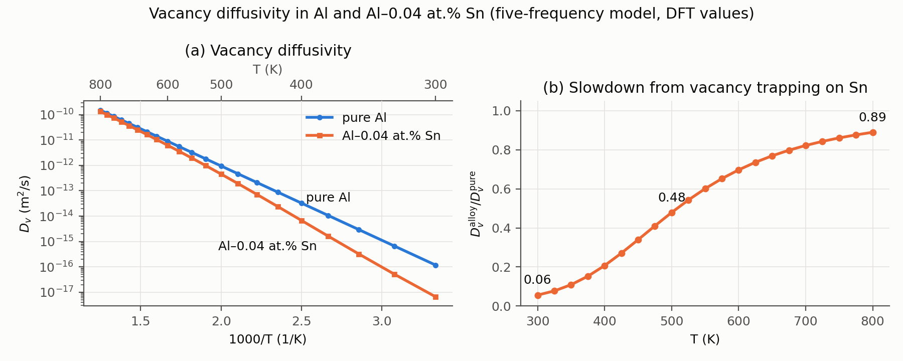

# Sn–vacancy pair in fcc Al: five-frequency model with KineCluE

Transport coefficients of a Sn solute–vacancy pair in fcc aluminium, computed with KineCluE using the
Lidiard–LeClaire five-frequency model, 500–900 K (and 300–800 K for the vacancy diffusivity), with DFT
barriers and attempt frequencies.

All five barriers and attempt frequencies are the Al–Sn values from the Wu/Morgan DFT dilute-diffusion
database (`../DFT_solute_diffusivity_all.xlsx`, sheet `Al-X`).

## Results (kinetic range 4, thermodynamic range 1)

| T (K) | L_vs/L_ss | Solute correlation f₂ |
|---|---|---|
| 500 | 0.843 | 0.0018 |
| 550 | 0.760 | 0.0035 |
| 600 | 0.663 | 0.0060 |
| 650 | 0.555 | 0.0097 |
| 700 | 0.443 | 0.0147 |
| 750 | 0.329 | 0.0212 |
| 800 | 0.217 | 0.0291 |
| 850 | 0.109 | 0.0387 |
| 900 | 0.007 | 0.0498 |

- **Vacancy drag:** L_vs/L_ss is positive over the whole range, so vacancies drag Sn along with them.
  But it falls steeply with temperature and is close to zero at 900 K. Extrapolating from 850 and
  900 K, drag reverses at about 904 K (909 K at kinetic range 6; ≈ 0.97 T_m, with T_m = 933 K), so in
  practice it holds over the whole solid-state range.
- **Correlation:** f₂ is very small (0.002–0.05) because Sn–vacancy exchange (w2 = 0.30 eV) is far
  faster than rotation (w1 = 0.80 eV) and dissociation (w3 = 0.60 eV): w2/w1 ≈ 2000 at 700 K. The
  vacancy swaps back and forth with Sn many times before it leaves, and most of those swaps cancel.
- **Absolute Lij** (m²/s) are in `CALC/AlSn_5FM_0.dat`; ratios are in `CALC/AlSn_5FM_0DR.dat`.
  Absolute values are per-cluster quantities and change with kinetic range, so use the ratios for
  physics.

## Total coefficients and Sn diffusivity

`total_lij.py` turns the pair coefficients into alloy coefficients for a given Sn fraction (default
C_Sn = 1e-3), with C_v = exp(Sf/k − Ef/kT), Ef = 0.6847 eV and Sf = ln 12 (the database's correction put
into the vacancy formation free energy; see Parameters). It works to first order in C_Sn. Only the pair
moves Sn, so the total L_vSn/L_SnSn equals the pair's drag ratio, and D_Sn = C_v·Z·l_SnSn does not
depend on C_Sn. The output is `CALC/AlSn_5FM_total.dat`.

| | D0 (cm²/s) | Q (eV) |
|---|---|---|
| D_Sn, uncorrected DFT (`--ef 0.4847 --sf 0`) | 0.0115 | 0.870 |
| D_Sn, default (Ef = 0.6847 eV, Sf = ln 12) | 0.138 | 1.070 |
| D_Sn, database | 0.139 | 1.070 |
| D_Al, default | 0.0646 | 1.266 |
| D_Al, database | 0.0646 | 1.266 |

With the corrected formation free energy, D_Al matches the database to within 0.06% at every
temperature. D_Sn is within 2.7% of the database's Arrhenius line from 500 to 900 K; the residual changes sign, so it comes from fitting a
straight line to a slightly curved ln D, and the fitted D0 depends on the range (Manning's analytical
f₂ fitted over 500–900 K gives 0.1375 cm²/s). D_Sn from the kira-6 run differs by under 0.4%.

The script also gives the vacancy diffusivity. In pure Al it is D_v = a²w0 (D0 = 0.00689 cm²/s,
Q = 0.581 eV = E0). In the alloy, D_v = L_vv / C_v,tot, where C_v,tot = C_v[1 + C_Sn(Z − Z0)] counts
the vacancies bound to Sn. Trapping by Sn slows the vacancies: at C_Sn = 1e-3, D_v is 29% of the
pure-Al value at 500 K and 84% at 900 K (fit: D0 = 0.0232 cm²/s, Q = 0.683 eV). C_v cancels in D_v,
so D_v doesn't depend on Ef or Sf.

**Validity.** The formulas are linear in C_v·C_Sn: they assume few Sn atoms hold a vacancy. The last
column of the output, C_v·(Z − Z0), is the ratio of bound to free Sn and should be ≪ 1. With the
defaults it is 0.005 at 500 K, 0.09 at 700 K and 0.23 at 800 K (0.47 at 900 K), so above about 700 K
D_Sn, L_vSn and L_SnSn are overestimated by roughly a factor 1 + C_v·(Z − Z0); L_vv, dominated by
free vacancies, much less. The database uses the
same linear formula, so the comparison above is like for like. D_v is affected much less: for C_Sn = 4e-4 it
is about 2% too low at 800 K and under 0.3% at 500 K. The script prints a note when the column exceeds 0.1.

## Vacancy diffusivity in Al–0.04 at.% Sn, 300–800 K

`num_AlSn_lowT_input.txt` reruns the numerical stage for 300–800 K (25 K steps) with the same model, and
`python3 total_lij.py --name AlSn_5FM_lowT --input num_AlSn_lowT_input.txt --csn 4e-4` writes
`CALC/AlSn_5FM_lowT_total.dat`.

| T (K) | D_v, pure Al (m²/s) | D_v, Al–0.04 at.% Sn (m²/s) | alloy / pure | C_Sn·(Z − Z0) |
|---|---|---|---|---|
| 300 | 1.18e-16 | 6.62e-18 | 0.056 | 49 |
| 350 | 2.92e-15 | 3.20e-16 | 0.109 | 13 |
| 400 | 3.26e-14 | 6.75e-15 | 0.207 | 5.0 |
| 450 | 2.12e-13 | 7.21e-14 | 0.340 | 2.3 |
| 500 | 9.50e-13 | 4.55e-13 | 0.479 | 1.3 |
| 550 | 3.24e-12 | 1.95e-12 | 0.601 | 0.77 |
| 600 | 9.01e-12 | 6.28e-12 | 0.697 | 0.51 |
| 650 | 2.14e-11 | 1.64e-11 | 0.769 | 0.35 |
| 700 | 4.49e-11 | 3.69e-11 | 0.822 | 0.26 |
| 750 | 8.54e-11 | 7.35e-11 | 0.861 | 0.20 |
| 800 | 1.50e-10 | 1.33e-10 | 0.889 | 0.16 |

C_Sn·(Z − Z0) is the excess of vacancies held by Sn relative to free ones (the Lomer term, since
Z − Z0 = 12(S·e^(Eb/kT) − 1)). The exact bound / free vacancy ratio, 12·C_Sn·S·e^(Eb/kT) / (1 − 12·C_Sn),
is slightly larger: 49.3 at 300 K, 1.28 at 500 K, 0.164 at 800 K. Trapping on Sn cuts D_v to 5.6% of the pure-Al value at 300 K and 89% at
800 K. ln D_v is curved, so read values from the table; a straight fit over 300–800 K gives D0 = 0.0431
cm²/s and Q = 0.700 eV (pure Al: 0.00689 cm²/s, 0.581 eV). D_v changes by under 0.1% between kinetic
ranges 2 and 4 at 300, 500 and 800 K.

D_v doesn't depend on Ef or Sf, but it does assume all the Sn is in solid solution. Sn solubility in Al
drops steeply at low temperature, so near 300 K this alloy is likely supersaturated. For 0.04 wt.% Sn
(≈ 0.009 at.%, `--csn 9.1e-5`) trapping is weaker: D_v / D_v,pure = 0.12 at 300 K, 0.49 at 400 K,
0.79 at 500 K and 0.97 at 800 K.

## Checks

**Thermodynamic range:** all three settings below give identical Z, dissociation rate, Lij and drag
ratios at every temperature. The convergence studies also agree on every kinetic range they share.
Only the bookkeeping changes:

| ThRa | Configuration classes | Jump classes | Notes |
|---|---|---|---|
| 4 (= KiRa, no reduction) | 41 | 158 | every shell and jump listed separately |
| 1 (used here) | 3: 1NN, 2NN, dissociated | 7 | 1NN→3NN/4NN merged into one w3/w4 class; 1NN→2NN kept |
| 0.75 | 2: 1NN, dissociated (2NN merged in) | 5 | one w3/w4 class for every 1NN dissociation |

They agree because the strict five-frequency model gives 2NN and beyond no binding and w0 jumps, so
extra classes only repeat the same values. ThRa 1 is kept so that a 2NN binding energy could be added
without changing the setup. With ThRa 0.75 the convergence study also reports a kinetic range of 1.0a.
That cluster is too small to be meaningful (drag ratio −1.64 to −1.66).

**Kinetic range convergence** (drag ratio L_vs/L_ss; kira 5 and 6 from the kira-6 run in `CALC_kira6/`):

| T (K) | kira 2 | kira 3 | kira 4 | kira 5 | kira 6 |
|---|---|---|---|---|---|
| 500 | 0.8160 | 0.8377 | 0.8430 | 0.8449 | 0.8458 |
| 700 | 0.3654 | 0.4274 | 0.4429 | 0.4487 | 0.4511 |
| 800 | 0.1219 | 0.1979 | 0.2171 | 0.2244 | 0.2274 |
| 900 | −0.0978 | −0.0142 | 0.0073 | 0.0156 | 0.0190 |

Kinetic range 4 is within 0.012 of kira 6 at every temperature. Below 800 K that is under 3%.
Near 900 K, where the ratio is close to zero, the relative error is large and the
value still rises with kira. If the exact reversal temperature matters, use kira ≥ 6.

**Against Manning's analytical f₂** for the five-frequency model
(f₂ = (2w1 + 7F w3)/(2w1 + 2w2 + 7F w3), with Manning's F(w4/w0)), using KineCluE's L_ss/L_ss⁰:

| T (K) | Manning | kira 2 | kira 3 | kira 4 |
|---|---|---|---|---|
| 500 | 0.00179 | 0.00181 | 0.00180 | 0.00179 |
| 700 | 0.01468 | 0.01507 | 0.01479 | 0.01473 |
| 900 | 0.04957 | 0.05161 | 0.05018 | 0.04983 |

KineCluE converges to the analytical result, which confirms the jump assignments and prefactors.

**500 K convergence file:** KineCluE's `convergence_analysis` used to skip any temperature where
every |Lij| < 1e-12 m²/s (an absolute tolerance), which left the 500 K file empty. `kinepy.py` now
makes that check relative to the largest Lij. The fixed output matches a rerun in `& UNITS debug`
(Lij ×1e8) to machine precision.

## Parameters

| Jump | Barrier (eV) | Attempt frequency (THz) |
|---|---|---|
| w0 bulk Al | 0.58143 | 4.2242 |
| w1 rotation 1NN → 1NN | 0.80046 | 4.1025 |
| w2 Sn–V exchange | 0.29848 | 2.0330 |
| w3 dissociation 1NN → 2NN/3NN/4NN | 0.60063 | 3.8920 |
| w4 association | 0.36456 | 4.3066 |

Lattice parameter 4.0391 Å (the database's DFT value). Sn–V binding at 1NN is Eb = E3 − E4 = 0.236 eV, zero
beyond 1NN. Every jump not touching the 1NN shell is w0, as in the strict five-frequency model.

The attempt frequencies differ, so the 1NN configuration carries an entropy prefactor
S = ν4/ν3 = 1.1065. Detailed balance between w3 and w4 needs it. KineCluE divides a jump's prefactor
by the starting configuration's S, so `make_5fm.py` writes ν·S for w1 and w2 and ν4 for w3/w4. All
five rates then equal ν·exp(−E/kT) with the dataset values.

KineCluE doesn't use the vacancy formation energy: its Lij are per Sn–vacancy pair. The sheet's Q
values add Ef = 0.4847 eV (DFT, `Host Information` sheet) and an empirical correction A_shift = 12,
E_shift = 0.2 eV that brings self-diffusion toward experiment. Pure Al: Q = 0.4847 + 0.5814 + 0.2 =
1.266 eV. Sn: Ef + E2 − Eb = 0.547 eV, plus about 0.32 eV from the temperature dependence of f₂ (taken
from the 500–900 K values above), gives about 0.87 eV. Adding E_shift gives the sheet's 1.070 eV.
Neither Ef nor the correction affects Lij ratios or f₂.

`total_lij.py` puts the correction into the vacancy formation free energy: Ef = 0.4847 + 0.2 = 0.6847 eV
and Sf = ln 12 ≈ 2.48 k. The DFT Ef is about 0.19 eV below experiment (≈ 0.67 eV), while the DFT
migration barrier (0.581 eV) is close to experiment, so the error sits mostly in formation. Every
coefficient except D_v is proportional to C_v, so this gives exactly the database's corrected D0 and Q,
and the same C_v enters the totals, D_Sn, D_Al and the validity check. The rest of the model (barriers,
attempt frequencies, binding, lattice parameter) stays all-DFT. Sf = ln 12 is at the top of the
experimental range for Al (about 0.7–2.4 k), so part of the factor 12 may belong to migration, and C_v
(6×10⁻⁴ at 800 K) is probably on the high side.

## Files and how to run

| File | Purpose |
|---|---|
| `main_AlSn_input.txt` | Analytical input: fcc lattice, vacancy + Sn, kinetic range 4, thermodynamic range 1 |
| `num_AlSn_input.txt` | Numerical input: 500–900 K, lattice parameter, drag-ratio output |
| `make_5fm.py` | Assigns each of KineCluE's jump classes to w0–w4 by its start and end configurations, and writes the energies into `CALC/configurations.txt` and `CALC/jump_frequencies.txt` |
| `run.sh` | Runs analytical stage → `make_5fm.py` → numerical stage (500–900 K, then 300–800 K) |
| `CALC_kira6/` | Same model run to kinetic range 6 (`& KINETICRANGE 6 1`), for the convergence check |
| `plot_results.py` | Makes `AlSn_5FM_results.png` from `CALC/` and `CALC_kira6/` |
| `plot_dv.py` | Makes `AlSn_5FM_Dv.png` (D_v in pure Al and Al–0.04 at.% Sn) from `CALC/AlSn_5FM_lowT_total.dat` |
| `total_lij.py` | Total Lij, D_Sn and D_Al from the pair coefficients (`python3 total_lij.py [CALC/] [--csn X] [--ef E] [--sf S]`; defaults Ef = 0.6847 eV, Sf = ln 12) |
| `num_AlSn_lowT_input.txt` | Numerical input for 300–800 K (output `AlSn_5FM_lowT`), used for the Al–0.04 at.% Sn vacancy diffusivity |

To use other barriers or attempt frequencies, edit the parameter block at the top of `make_5fm.py` and run `./run.sh`
(about 10 s).

Requires the `sympy-numpy-compat` branch of KineCluE (fixes for current SymPy/SciPy).

Energy convention (KineCluE): configuration energy = −Eb (Eb > 0 is attraction), and saddle-point
energies are absolute, with the dissociated pair at 0 eV. So a barrier from the 1NN configuration
is E_saddle + Eb. Jump prefactors are in THz.

## Sources

- [Wu, Mayeshiba & Morgan, High-throughput ab-initio dilute solute diffusion database (Sci. Data 2016)](https://pmc.ncbi.nlm.nih.gov/articles/PMC4950524/)
- [Energetics of point defects in aluminum via orbital-free DFT](https://arxiv.org/pdf/1611.07631)
- [First-principles calculations of solute–vacancy interactions in aluminum](https://cpb.iphy.ac.cn/article/2020/2032\cpb_29_6_066103.html)
- [Uni Halle open-data record (vacancy–In/Sn complexes in Al)](https://opendata.uni-halle.de//handle/1981185920/81764)
- [Simonovic & Sluiter, Impurity diffusion activation energies in Al from first principles (PRB 2009)](https://link.aps.org/doi/10.1103/PhysRevB.79.054304)
- [Mantina et al., First principles impurity diffusion coefficients](http://www.mmm.psu.edu/MMantina2009_Acta_DiffusionCoefficient.pdf)
- T. Schuler, L. Messina, M. Nastar, KineCluE, Comput. Mater. Sci. (2019), doi:10.1016/j.commatsci.2019.109191
